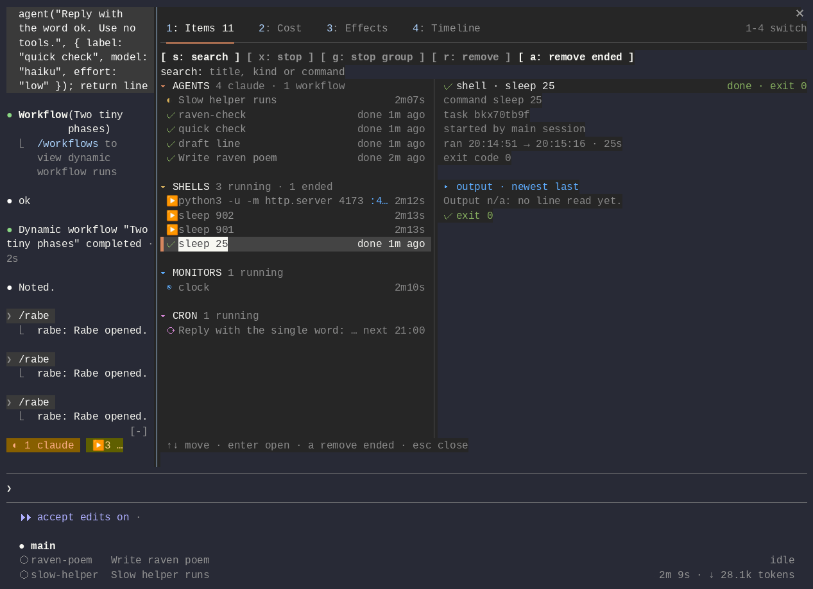
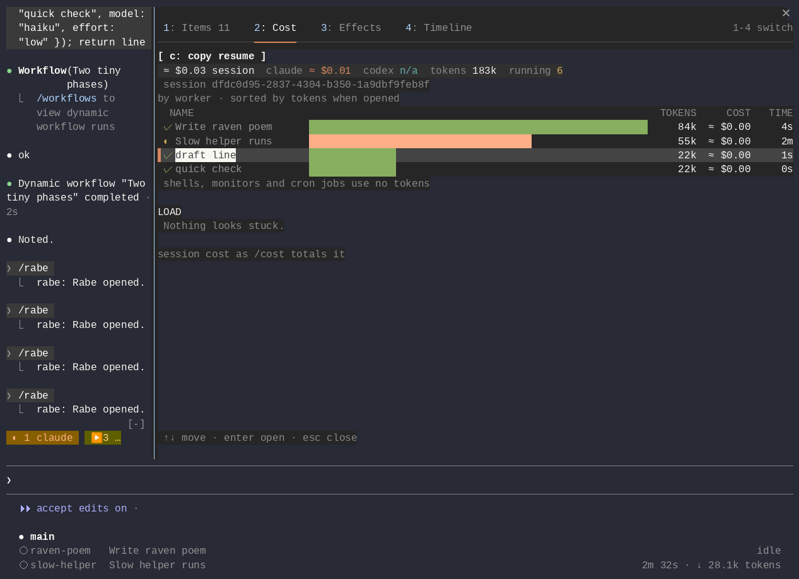
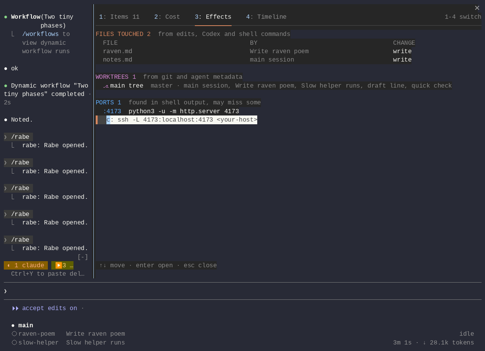

<picture>
  <source media="(prefers-color-scheme: dark)" srcset="docs/assets/banner-dark.svg">
  
</picture>

# rabe

**See what Claude Code runs in the background.**

Rabe (German for raven) is a Claude Code mod. It shows your subagents, Codex jobs, background shells, monitors, cron jobs and workflows in one place. A short band above the prompt shows what runs now. The `/rabe` command opens a pane with the full detail.

![Rabe in a Claude Code session: the band above the prompt is one line of counts, two claude, three shells, one monitor and one cron, with the cost; /rabe opens the pane with the items grouped by kind, the arrow keys move through the list and the detail beside it follows with the agent's id and estimated cost, a click selects the shell an agent started, indented under that agent, and a second click opens it, b goes back, the Effects tab shows a file an agent wrote through the shell (via shell), one the main session wrote, the worktree and a port, the Cost tab shows the estimate in dollars per agent and the session id, the Timeline tab shows the bars, who started what and the previous session with its cost and background tokens on separate labelled lines, and Esc closes the pane](docs/assets/demo.gif)

Status: early development. See [releases](https://github.com/lorenzh/rabe/releases), the [changelog](CHANGELOG.md), and the [documentation index](docs/README.md).

## What Rabe shows

| Kind | In the band | In the pane |
|---|---|---|
| Claude subagents | Count (`claude`) | Name when Claude Code provides one, otherwise the task description; tokens, prompt, turns and agent id |
| Workflows | Count (`workflow`) | Phases and their agents in start order, with tokens and time; select an agent to open it |
| Codex jobs (from the Codex plugin) | Count (`codex`) | Model, effort and sandbox, tokens, the prompt, each message and command with its exit code, the thread id (`c` copies `codex resume <thread id>`) |
| Background shells | Count (`shell`) | Bash description and task id, output lines, exit code and guessed port |
| Monitors | Count (`monitor`) | Each line with the time Rabe received it |
| Cron jobs and `/loop` wakeups | Count (`cron`) | The next five runs while running; deleted jobs say `deleted` |
| Cost | Session cost and tokens of the background work | Cost tab: tokens and an estimate in dollars (`≈ $0.16`) per worker, workers that look stuck |

The band is one line of counts, one chip per kind with failures from the last 10 minutes first (`✗ 1 shell failed`), then the cost, under an empty row so the status line above does not touch it. Its cost label says `session`; its token label says `bg` and includes the cached share when known. It shows the session cost Claude Code reports, or `session n/a` when that cost is unknown; it does not replace it with a sum of worker estimates or show a top-agent suffix. It shortens readable chip labels only when the full labels and cost do not fit; when needed, it puts the dollar amount first and drops the token part. When Claude Code gives the band only one row, the empty row goes. The names are in the pane. When nothing runs, it draws nothing.

When the readable form repeats the cron expression, cron detail shows the schedule once. Workflow detail says `1 agent` for one child in both the run facts and cost panel.

The pane has four tabs:

- **Items**

  

  All items grouped by kind, with a search field. Stop group and remove ended act only on rows the search shows. The agent, shell, monitor and cron headers show running and ended counts. The agent header also counts idle teammates and shows counts by kind. Shell rows show the Bash description or command, followed by the task id. Rabe collapses command whitespace for the row. A shell with no lines says `No output yet` while it runs and `No output` after it ends. Shells and monitors that an agent started show under the name of that agent. A Codex job shows under the agent that started it, also when it starts while the pane is open. The Codex plugin starts its jobs through a Claude agent that only passes the request on (`codex:codex-rescue`); that agent has no row of its own, and its tokens and cost count toward the job. Rabe links the two only when the evidence fits one job: the agent's command named the job, or the job started while the command ran and has its prompt or its thread. A link made by the prompt is checked again when the command returns: if it names another job or thread, the link moves to that job, and while two jobs fit, neither is linked. In the job's detail, `f` opens the agent, with its turns, id and transcript. If the pane is 90 columns or wider, the selected item shows beside the list. Turns with tools and no text show only their tool lines. Cron forecast times use the same duration format as the rest of the pane. The group-stop button shows how many rows `g` will stop.

  Idle teammates show `idle` in Items, Cost and Timeline. They count as neither running nor ended. The band excludes them from work counts. Cost never flags them stuck. Remove ended keeps them. Plain subagents keep their existing behavior.

  You can message or stop an idle teammate. Waking it restores running under the same id. Timeline keeps a continuous lifetime bar through idle gaps. Agents held on work or approval (`waiting`) still count as running.

- **Cost**

  

  The session cost as `/cost` totals it, this session's id (`c` copies `claude --resume <id>`), the estimated dollars of the Claude agents and of the Codex jobs when those sources exist, and per agent and Codex job a bar of tokens and its estimate. Worker names use more of the pane width. The header says "sorted by tokens when opened". Workers keep that order while the pane is open, and new workers follow them. Agents that look slow or stuck show under "Load".
- **Effects**

  

  Files that agents, Codex jobs and the main session changed, with who changed each and how (`edit`, `write`, `codex add`, `deleted`), a warning when two of them change the same file, the git worktrees files changed in with their branch and who worked there (the main session included), and open ports with the `ssh -L` command to reach them. Long file paths use a middle ellipsis and keep both ends. When a file has multiple changes, the label says `N changes: write, edit`. Files written through shell commands show as `via shell` when Claude Code reports them in a Bash diff or Rabe confirms them on disk. Script edits need `auto` mode or the Claude Code setting `bashEditDiffEnabled: true` in your user settings (project settings do not count). Shared, skipped or unavailable diffs leave only the disk fallback. Relative paths use the main session's current folder or the agent's known cwd. Unknown folders and uncertain directory changes show nothing for relative paths. Without a usable Bash diff, Rabe skips commands inside `if` or loops and paths with a glob or `$var`. Script edits without a usable diff stay invisible. Background commands record no edits. Enter or a click on a file opens the agent or Codex job that changed it last, or copies the path of a main-session file. In a Git repository each file shows relative to the worktree that holds it.
- **Timeline**

  

  A bar per item over the last 4 hours, who started what, and a summary of the previous session in this project with its id (`c` copies `claude --resume <id>`; a summary saved by Rabe 0.3 or older shows `n/a`). A short Timeline window shows its start time when no round clock label fits. Cron ticks show scheduled runs, without delays while the session is busy or jitter. Its cost and duration are the whole session's, its tokens only the background items'; each line says which. Items that ended before the window fold into one line (`+37 older items, ended before 10:20`); a bar that started earlier is cut at the left edge with `◂`. `w` widens the window for the open pane, from 4 hours to 12 hours to the whole session.

## Install

Type this at a Claude Code prompt:

```
/plugin install rabe --marketplace lorenzh/rabe
```

Then run `/reload-plugins` or start a new session: a plugin you install does not load in the running session.

## Usage

The band shows by itself while background work runs. Type `/rabe` to open the pane, including while Claude is working. In the terminal the pane docks beside the transcript. Drag its left edge to make it wider.

| Key | What it does |
|---|---|
| ↑ / ↓ | Move to the previous / next row; the detail beside the list follows. In a scrolling pane, arrows and view-changing presses take turns while they move focus; a pending stop, delete or message does not block them |
| Enter | Open the row that has the focus, also after a click selected another row |
| Click on a row | Select the row; click it again to open it. A click on the row that has the focus opens it at once |
| Tab / Shift+Tab | Move the focus through rows, tabs and buttons |
| `b` | Go back to the list |
| `1` to `4` | Switch tab and focus its marked row. An empty tab keeps the focus on its label |
| `s` | Focus search. Enter returns to the marked row |
| `x` | Stop the selected item |
| `g` | Stop the group among rows the search shows (the button shows its count), or the workflow run of the selected run or workflow agent |
| `r` | Remove the selected row once it is done, failed or stopped |
| `a` | Remove every done, failed or stopped row the search shows |
| `m` | Send a message to an agent. Enter sends it and gives the keys back to the pane |
| `f` | Open the Claude agent that forwarded a Codex job (it has no row of its own); `b` then goes back to the job's row |
| `c` | Copy the command, the prompt, the `ssh -L` line, an agent's id, or the command that resumes a session or a Codex thread. If the clipboard cannot be reached (for example over SSH in a terminal without OSC 52), a message shows the text to select |
| `d` | Delete a running cron job |
| `w` | On the Timeline tab: show more time (4 h, 12 h, the whole session, then 4 h again) |
| Mouse wheel | Scroll the pane |
| Esc | Close the pane |

A deleted cron job shows no next runs, and its delete button stays dim. The previous-session summary counts only cron jobs still running when the session ends. Delete failures show plain text.

After Rabe successfully stops work, stops a group, deletes a cron job or sends a message to an agent, it adds a short note with the item kind and id to the next prompt's private context. Titles, prompts and message text are never included. Notes are capped at 20 and clear after that prompt enters.

The buttons under the tabs show the actions of the current view. Unavailable controls keep their visible labels and stay dim. Their hotkeys do nothing and stay caught while the pane holds the keys outside input fields. Rabe adds no blank buttons for letters a view does not own.

If a list redraw removes a row or search handler during an event, Rabe drops that stale action and keeps the pane's keys.

When all rows fit, fast arrow bursts after a tab switch keep their order and wrap direction. A second tab press keeps arrows received during the first switch. After a refused focus move, later independent arrows go straight to the engine.

| View | Letters caught outside input fields |
|------|-------------------------------------|
| Items list | `x g r a`; `s` where search is available |
| Agent detail | `b c x`; `m` on surfaces that support input fields |
| Workflow agent detail | `b c`; `g` when the parent run is known; no `x` or `m` |
| Workflow detail | `b g` |
| Shell or monitor detail | `b x`; `c` when a command is known |
| Codex detail | `b x`; `c` when a thread id is known; `f` when a forwarder is known |
| Cron job detail | `b c d` |
| Scheduled wakeup detail | `b c`; no `d` |
| Cost | `c` when the current session id is known |
| Effects | `c` on the first port's SSH row while that port exists |
| Timeline | `w` when `timelineHours` is greater than zero; `c` when the previous session id is known |

Other letters still reach the prompt because the mod API has no key hook. The letters above also reach the prompt in views without their control. For example, `x` reaches the prompt on Cost and `w` does so on Timeline with `timelineHours: 0`. A focused input field takes every key.

An opened item keeps its recorded turns, steps or output lines in its detail. Use ↑↓, PageUp, PageDown or the wheel to scroll. The scroll hint shows only when the opened detail needs scrolling. Claude Code sets the pane's height. The split preview marks hidden agent text or counts older output lines. Press Enter to open the full detail.

Agent answers keep up to 16,000 characters each. Longer answers end with `…`. The transcript keeps the original answer. Markdown stays plain text. Wrapped bullet and numbered lists keep their markers beside the start of a long path. Long tool summaries end with `…`. Answers already shortened by an older version stay shortened.

Shell and monitor commands and cron prompts appear in full in the detail. Text wraps at the detail width. Each CR, LF or CRLF line break shows `↵`. Read the full text before pasting it into a shell. Copy does not check commands or prompts. Pasted commands run with your shell's permissions.

Copy replaces terminal control and format characters with `?`. Commands and prompts keep tabs and line breaks. Single-line fields refuse CR or LF: ids, paths, `ssh -L` lines and resume commands. Resume ids and agent ids must match `[A-Za-z0-9_][A-Za-z0-9_.-]*`. Invalid ids show `n/a` with no copy button.

A success toast names the copied field and counts its text: `Copied command · 3 lines · 412 chars`. CRLF counts as one line break. Characters are Unicode code points after the control and format filter. Success toasts contain no copied text.

Other toasts flatten whitespace and replace Unicode control (`Cc`) and format (`Cf`) characters with `?`. Wide characters, emoji and combining marks stay. Toasts name deleted cron jobs by id. Copy failures show the reason through the same filter. Reasons include `no-clipboard` and `refused`. If the filter leaves the copied text unchanged, the failure toast offers the exact text. Cron prompts never appear in toasts.

The search button shows the active query, cut with `…` when long. The search field keeps the full query at every width. The filter stays visible after Enter and after reopening the pane. To clear it, submit an empty search. Stop group and remove ended act only on the filtered rows.

With the mouse, click a row once to select it and again to open it. Click a tab to switch to it, a group name to fold the group, a button to press it, or a row on the other tabs to open it. The wheel scrolls the pane. A click does not move the focus, so Enter still opens the row that has the focus. A click also does not give the pane the keys: `ctrl+x tab` does. The mouse works only in Claude Code's fullscreen layout: type `/tui fullscreen` to turn it on. Without it, use the keys.

On the list, the stop keys `x` and `g` and the remove key `r` work only after you move onto a row yourself, with an arrow, Tab or a click. Until then, and after the view or the selected row changes without you, they are dim, so a key press never stops something you did not pick. If they stay dim after a click, the pane does not have the keys yet: press `ctrl+x tab`, then move onto the row with Tab or an arrow.

`/rabe` asks for the keyboard as soon as the command clears the prompt. Arrows also follow rapid view changes when every row fits.

While the pane is open, rows and buttons keep their places, so Enter acts on what you see under the focus. An item that starts after you open the pane goes into the group of its kind, after the rows already there; on the Effects tab, a new file or port goes into its section the same way. When it comes above the focused row, Rabe moves the focus back onto that row; until then, Enter on a row does nothing. A row that is gone leaves the Items list and the Effects tab at once, and the same rule applies: when the focused row moves up, Enter on a row does nothing until Rabe moves the focus back; when the focused row itself is gone, Enter on a row does nothing until you move the focus. Buttons and tabs never move. In an open item and on the Cost and Timeline tabs, a row that is gone stays as a dim `gone` slot until you change the view or close the pane. Type `/rabe` again to sort the lists.

Removed rows stay off the list, the Cost and Timeline tabs, a workflow's agent rows and the band's counts for the rest of the session. They still count in a workflow's phases and tokens, in the cost totals and on the Effects tab, so a summary never loses work that ran. Running items are never removed; an item that runs again shows again. Ended items stay hidden even when a poll finds them again. A removed row leaves the list at once, with no `gone` slot; when it was the selected row, the keys go dim until you move onto a row again.

Ended items keep their stop buttons in place. These buttons stay dim. Pressing them does nothing.

Commands:

- `/rabe`: open the pane.
- `/rabe-stop codex:<job id>`: cancel a running Codex job. `x` in the pane does the same.
- `/rabe-diag`: show what each source read in its last poll, with versions and options, and no prompts, titles or full paths. Run it when something shows `n/a` or is missing.
- `/rabe:report-bug`: write a bug report for this repository.
- `/rabe:feedback`: write an idea or a comment for this repository.

The two report commands show you a draft first. They create a public GitHub issue only after you say yes. Without the `gh` CLI they give you a link to open instead.

### The cost estimate

Claude Code reports tokens per agent but no dollars, so Rabe estimates them: the tokens of each model request times the list price of its model in `data/prices.csv` (USD per million tokens, standard API prices, checked 2026-10-09). The pane marks the estimate with `≈`. The session cost from `/cost` stays the real total. Rabe prices:

- Claude agents per request: uncached input, cache reads, cache writes (at the 5-minute price, since Claude Code does not report which writes last an hour; subagents write 5-minute entries almost always), and output. Haiku 5.5 prices a whole request at its long-context rates once the prompt is over 100k tokens.
- Codex jobs per request from the Codex session file: input less cached input at the input price, cached input at the cached price, cache writes at the write price, and output (reasoning included). Above 272k of prompt a request takes the model's long-context rates. A job that resumes a Codex thread (`--resume-last`) counts only the requests made after it started, not those of the jobs before it on that thread.

The estimate shows `n/a` when Rabe cannot know it: a model that is not in the table, an agent that started before Rabe loaded, a Codex session file over 4 MiB (Rabe reads only its start and end) or one that is gone or cannot be read, a request over the long-context limit of a model that OpenAI bills per session (GPT-5.4, GPT-5.5), or a request without its counts. A Codex job that counts its forwarding agent is `n/a` when the job or the agent has no estimate, and so are its tokens when one of them has none. A total is `n/a` when one of its workers has no estimate, also a worker without token data (for example a finished Codex job whose session file is gone), since a smaller sum would read as the whole cost. Codex plan billing, Bedrock, Vertex, batch, fast or regional rates are not in the table.

## Where the data comes from

Rabe gets most data from the mod API: hooks for tool calls, agent starts, agent steps and task notifications. The rest comes from files that Claude Code and Codex write while they work. These files have no documentation and can change in any release. A value that Rabe cannot read shows as `n/a`.

Rabe cannot see some things:

- Dollars per agent or per Codex job. No source gives them; Rabe estimates them from its price table (see [the cost estimate](docs/architecture/prices.md)).
- Work that started before Rabe loaded shows only what the agent list, `CronList` and the files tell.
- The port of a shell is a guess from its output.
- Codex jobs started outside the Codex plugin, and Codex sessions that Codex already deleted.
- Retries inside a workflow. Rabe can stop a whole workflow run, but not one agent of it.

[What Rabe can see](docs/feasibility.md) links to each source and its limits.

## Privacy

Rabe runs on your computer and makes no runtime network requests. Successful stop, delete, and message actions add notes that name each item by kind and ID to the next prompt sent to Claude. The two report commands create a public issue only after you approve the draft.

Rabe reads these files:

- The meta files of subagents, next to the session transcript in `~/.claude/projects/`.
- The script of a workflow run in this session’s `workflows/scripts/` folder under `~/.claude/projects/` (or `CLAUDE_CONFIG_DIR`).
- The output files of background shells and monitors in this session’s `/tmp/claude-<uid>/<project>/<session>/tasks/` folder.
- The Codex plugin's job files under `~/.claude/plugins/data/codex-openai-codex/`, and `~/.claude/plugins/installed_plugins.json`.
- Codex session files under `~/.codex/sessions/` (or `CODEX_HOME`).
- Its own price table `data/prices.csv`, its `.claude-plugin/plugin.json` (for the Rabe version in `/rabe-diag`), and the file the option `pricesFile` names.
- The size and modification time of the files a shell command names, before and after the command, to see which ones it wrote. Rabe does not read their content.

For script edits, Rabe also takes changed file paths and known deletions from Claude Code's Bash result. It keeps no diff hunks or file content.

Rabe checks each output and script path against the current session and project before reading. It also checks the resolved file against the resolved folder to reject symlink escapes. If a path is unexpected or cannot be resolved, its file data stays `n/a`.

Stop, remove and message toasts name items by kind and ID. They omit titles and agent names from files.

Rabe keeps its items in Claude Code session state. That includes agent reply text (up to 16,000 characters per turn), prompts, commands, IDs and paths. When a session ends, Rabe keeps a short summary for the next session in the same project. The summary holds the session id, counts per kind, tokens, cost and the kind and ID of each failed item. When Rabe reads an older summary, it removes stored failed titles. An empty session also removes these titles.

Rabe polls its sources in one loop. A slow poll makes the loop skip ticks. Starting the session again replaces its timer and polls. A failed poll leaves the other sources running. Item counts change together after the loop finishes. The loop polls every two seconds while work runs and every ten seconds after five unchanged idle polls. Agent polls keep a minimum three-second gap.

Rabe keeps file cursors and parser summaries in session state. It skips unchanged files and reads only appended bytes. Shell and monitor output continues past 4 MiB. Rabe checks file size and modification time first. Changed output and rollout files use `ls -diL` to detect replacement and `tail` to read appended bytes. Job metadata caches work without process access. On desktop, Rabe reads small changed rollouts whole and skips unchanged rollouts. Output and its cursor commit together in session state. Cached fields and exit results remain available after a discarded or failed item update. Later polls apply them again. Agent metadata applies only while each field still matches its value before the file read. This recovers lost updates and preserves newer event values. Rotation clears oversized-record discard mode. Invalid restored caches and cursors are rebuilt. Wrong-type rollout steps, edits or tokens cause a new file read. It runs `git worktree list` every 10 seconds in the session's folder to know the worktrees. When you stop a Codex job, it runs the Codex plugin's own cancel script. A refusal sends fixed text to Claude. The pane toast can show the first error line.

`/rabe-diag` prints versions, option values (`pricesFile` only as set or not set), item counts and per-source poll counts (content reads, characters and UTF-8 bytes returned, and files skipped as unchanged) with fixed error categories. It contains only fixed words, numbers and versions. It contains no raw errors or file names. A failed report says `diagnostics unavailable`. A refused command registration does not interrupt session start. Counts describe returned data, event reads can overlap a poll, and a clean poll does not prove that discovery found everything. `/rabe:report-bug` receives the same safe diagnostics in its context. If that context is unavailable, it asks you to run `/rabe-diag`. It includes the details you provide, reproduction steps, Rabe and Claude Code versions, your operating system and any error lines you give it. Both report commands ask Claude Code to leave out home paths, user or project names, prompts, tokens and email addresses; `/rabe:report-bug` also asks it to leave out transcript text. These are instructions, not automatic redaction filters. Review the full draft before approving it. See [SECURITY.md](SECURITY.md) to report a vulnerability privately.

## Requirements

- Claude Code 2.1.296. We build and test Rabe with this version. Other versions can show `n/a` where a file changed.
- A terminal for the colored band and pane. The maintainer last checked the Claude desktop app on Windows with Rabe 0.1.0. Desktop support is unverified since that check. [#117](https://github.com/lorenzh/rabe/issues/117) investigates current desktop support.
- Optional: the Codex plugin (`codex@openai-codex`) for Codex jobs, and the `gh` CLI for the report commands.

## Development

Install the tools with [Bun](https://bun.sh) 1.4. Then start Claude Code with the mod from this folder. When you save a file, the mod reloads.

```sh
bun install
claude --plugin-dir .
```

Run all checks (lint, type check, manifest check and tests), as CI does:

```sh
bun run check
```

[Contributing](CONTRIBUTING.md) explains the setup, workflow and review process. [How to test Rabe](docs/testing.md) covers the tests and live checks with `scripts/live-check.sh`. [AGENTS.md](AGENTS.md) has the rules for coding agents, and [Security guidelines](docs/security.md) the security rules for changes and review. [The documentation index](docs/README.md) links to the architecture and feasibility guides. See the [user guide](docs/guide.md) for options and common problems.

## Feedback and bugs

In Claude Code, `/rabe:report-bug` and `/rabe:feedback` draft an issue for this repo. You check the draft before anything is sent. They use the `gh` CLI when you are logged in, and otherwise give you a link to a prefilled issue. You can also [open an issue](https://github.com/lorenzh/rabe/issues/new/choose) directly.

## License

[MIT](LICENSE)
